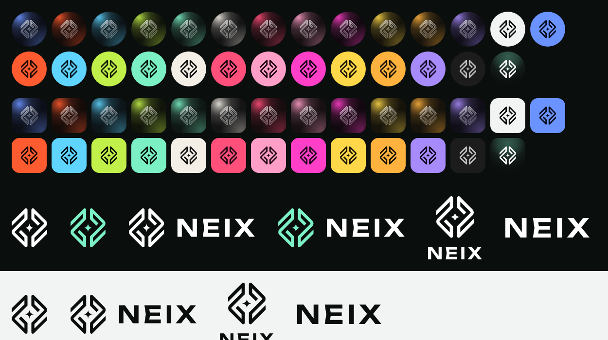

# NEIX — логотип и иконки / logo and icons

Всё в SVG: масштабируется без потерь, открывается в браузере, Figma, Illustrator,
Inkscape. Надпись NEIX переведена в контуры — шрифт ставить не нужно.

Everything is SVG: scales without loss, opens in any browser, Figma, Illustrator or
Inkscape. The NEIX wordmark is outlined, no font needed.

## Что внутри / What is inside

| Папка / Folder | Что / What |
| --- | --- |
| `logo/neix-mark-*.svg` | Знак без надписи: `white` — для тёмного фона, `black` — для светлого, `mint` — фирменный цвет. / The mark alone: white for dark backgrounds, black for light ones, mint is the brand colour. |
| `logo/neix-logo-horizontal-*.svg` | Знак и надпись в строку. / Mark and wordmark side by side. |
| `logo/neix-logo-vertical-*.svg` | Знак над надписью. / Mark above the wordmark. |
| `logo/neix-wordmark-*.svg` | Только надпись NEIX. / The wordmark alone. |
| `icons/circle/` | 27 иконок приложения кругом (как на Android). / The 27 app icons as circles (as on Android). |
| `icons/square/` | Те же 27 иконок скруглённым квадратом (как на компьютере). / The same 27 as rounded squares (as on a computer). |

Иконки — те же, что в приложении (Настройки → Оформление → Иконка приложения):
`classic`, `light`, `mono`, а также `glass-*` и `material-*` для каждой из 12 палитр —
`mint`, `raspberry`, `pearl`, `signal`, `tunnel`, `ember`, `ice`, `cobalt`, `violet`,
`lime`, `sakura`, `sun`.

The icons are the ones the app offers (Settings → Appearance → App icon): `classic`,
`light`, `mono`, plus `glass-*` and `material-*` for each of the 12 palettes.

## Как можно использовать / How you may use them

**Можно** — чтобы указать на NEIX:

- в статьях, обзорах, видео, инструкциях и сравнениях VPN-клиентов;
- на сайте, в боте или канале провайдера: «Подключайтесь через NEIX», кнопка
  «Скачать NEIX», список поддерживаемых приложений;
- в каталогах приложений и подборках со ссылкой на NEIX.

**Нельзя:**

- выдавать своё приложение, сервис или подписку за NEIX или за официальный продукт NEIX;
- ставить знак логотипом своего продукта, сервиса или канала;
- менять знак: пропорции, форму, цвета вне этого набора, добавлять к нему элементы;
- продавать сами файлы или включать их в платные наборы иконок.

Провайдеры с премиум-подпиской показывают в NEIX свой собственный логотип
(`branding.logoUrl`), а не этот.

**You may**, to refer to NEIX: articles, reviews, videos, guides and comparisons of VPN
clients; a provider's site, bot or channel ("Connect with NEIX", a "Get NEIX" button, a list
of supported apps); app directories and lists that link to NEIX.

**You may not:** present your own app, service or subscription as NEIX or as an official
NEIX product; use the mark as the logo of your product, service or channel; alter the mark
(proportions, shape, colours outside this set, added elements); sell the files themselves
or bundle them into paid icon packs.

Шрифт надписи — Unbounded (SIL Open Font License 1.1). Код и само приложение — по
[LICENSE.md](../LICENSE.md). / The wordmark's typeface is Unbounded (SIL OFL 1.1); the app
and its code are under [LICENSE.md](../LICENSE.md).
